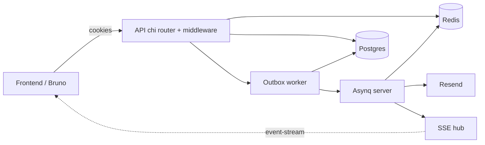
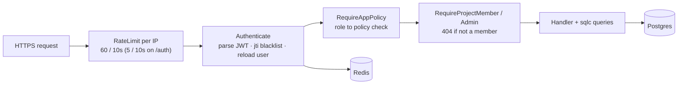
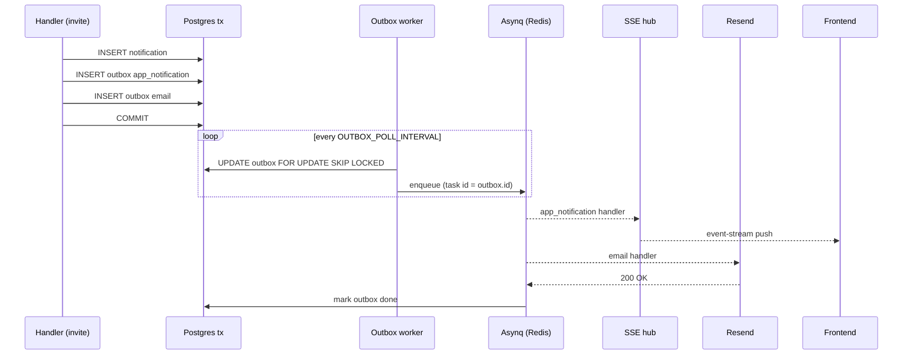
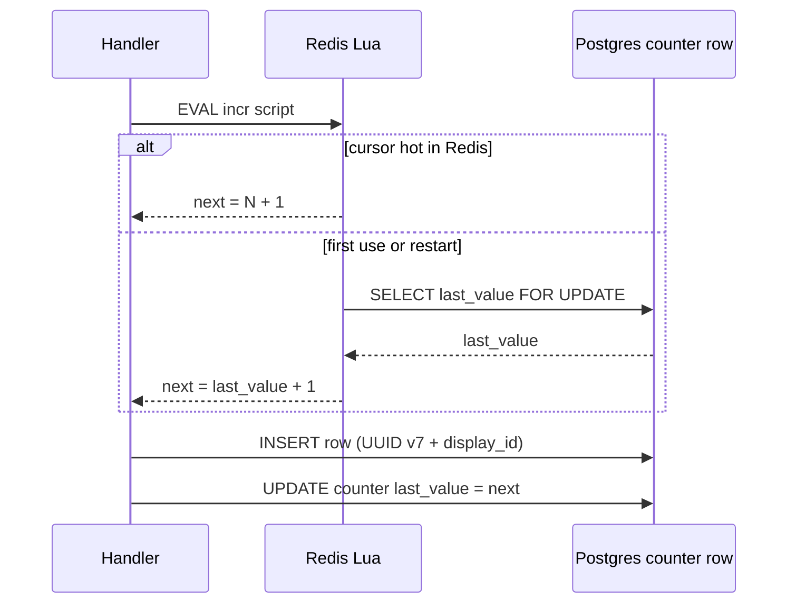
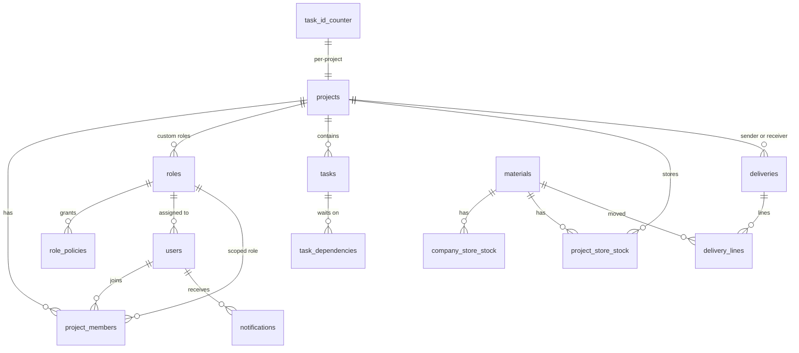

# SiteTrack

Backend API for SiteTrack — a construction project and materials tracker.
Go 1.26 · PostgreSQL 17 · Redis 7 · one `docker compose up` to run.

- 60+ endpoints · see [`bruno/`](./bruno) for the API client collection.
- 6 migrations grouped by domain · `migrations/00{1..6}_*.sql`.
- Real end-to-end tests · `go test -tags=e2e ./test/e2e` (dockertest spins
  up Postgres + Redis, 88 subtests across auth, projects, tasks,
  materials, deliveries, invitations, roles, escalation).

---

## Run it

```bash
cp .env.example .env
# put your Resend API key (only required for outbound invitation emails):
# RESEND_API_KEY=re_xxx
docker compose up
```

That starts Postgres, Redis, runs the migrations, and starts the API on
`:8080`. The seed container is a `--profile seed` opt-in:

```bash
docker compose --profile seed run --rm seed
```

Dev loop (Postgres + Redis in containers, API on the host):

```bash
docker compose -f docker-compose.dev.yml up -d postgres redis
go run ./cmd/api
```

Health check: `curl http://localhost:8080/health`.

---

## System overview

### High level



### Request pipeline

Every request walks the same middleware chain before a handler runs:



1. `RateLimit` buckets by canonical client IP.
2. `Authenticate` parses the access-token cookie, checks the jti
   blacklist in Redis, reloads the user from Postgres so a fresh
   `app_role` is used on every request.
3. `RequireAppPolicy` checks `role_policies` for app-level actions
   (company store, materials, roles…). `email-available` short-circuits
   via an in-process Bloom filter (see `internal/auth/bloom.go`) so the
   common "brand-new email" path never touches Postgres.
4. `RequireProjectMember` / `RequireProjectAdmin` reads
   `project_members` and returns **404** (not 403) if the caller is not
   a member. SuperAdmin bypasses.
5. The handler runs its service layer; writes go through `sqlc`
   against `pgxpool`.

### Notification + email write path



The DB transaction is the single source of truth. Redis or Resend can
fail — the outbox worker retries with exponential backoff
(`OUTBOX_MAX_ATTEMPTS`). Nothing is lost, nothing is duplicated (the
Asynq task id is `outbox.id`).

### ID generation path (`PRJ-0001`, `PRJ-0001-T-0001`)



UUID v7 is the primary key everywhere (timestamp-ordered,
index-friendly). Display IDs come from a Lua-scripted Redis counter
with a Postgres floor, so two parallel create requests cannot collide.

A single process runs the HTTP API, the outbox dispatcher, and the
Asynq server (`cmd/api/main.go`). Postgres is the source of truth.
Redis holds session jti blacklist, ID-generator cursors, invite TTL
keys, and the Asynq queue. Emails leave through Resend. Real-time
notifications are delivered via SSE (`/notifications/stream`) from an
in-process hub.

---

## Database



`outbox` is intentionally not linked: it mirrors `notifications` and
email jobs but does not reference them with a foreign key (it's the
durable work queue picked up by the background worker).

Six migrations, one concern per file:

| File | Tables |
|---|---|
| `001_auth.sql` | `app_roles`, `role_policies`, `users` (+ seed 3 roles and their policies) |
| `002_projects.sql` | `projects`, `project_members`, `project_id_counter`, member-count trigger, pg_trgm indexes |
| `003_tasks.sql` | `tasks`, `task_dependencies`, `task_id_counter`, `blocked` recompute + task-count triggers |
| `004_inventory.sql` | `materials`, `company_store_stock`, `project_store_stock`, `deliveries`, `delivery_lines`, enums |
| `005_notifications.sql` | `notifications`, `outbox` |
| `006_merged_roles.sql` | merges `app_roles` → `roles` with a nullable `project_id`; seeds per-project Admin + Member; migrates `project_members.is_admin` to `role_id` |

Stored, trigger-maintained counters that matter for the Projects list:
`projects.member_count`, `task_count_not_started / in_progress / done`,
`tasks.blocked`, `tasks.dependents_count`. `late` is computed per request
against `CURRENT_DATE` — it would be wrong-by-design as a stored value.

---

## Patterns

### Transactional outbox (notifications + email)

Every invitation writes one DB transaction: the `notifications` row, an
`outbox` row for the in-app push, and an `outbox` row for the email. A
background worker claims rows with `UPDATE … FOR UPDATE SKIP LOCKED`,
enqueues an Asynq task, and marks the row done on success. The in-app
push fans out through the SSE hub; the email goes to Resend. If Redis or
Resend is down the DB still has the record, and the worker retries with
backoff. See `internal/worker/` and `migrations/005_notifications.sql`.

### Session revocation (jti blacklist)

Access and refresh tokens carry a `jti`. Logout and refresh write that
`jti` into Redis with the token's remaining TTL. Every request parses the
token, checks Redis, and re-reads the user from the DB. The access
window is 15 minutes, the refresh window 7 days — long enough that
nobody is asked to log in while actively using the app, short enough
that a stolen access token dies. Refresh is single-use (`SETNX`) so a
leaked refresh token can be used at most once.

### Role changes take effect on the next request

There is no `token_version`. The access token carries `app_role`, but
the request handler re-reads `app_role` from the DB on every call. A
SuperAdmin flipping a user to `company_store_manager` is honoured on
their very next request without forcing a logout.

### 404 for non-members (not 403)

Project IDs are easy to guess. Any project-scoped route is wrapped in
`RequireProjectMember` middleware that returns `404 project not found`
if the caller is not a member (SuperAdmin bypasses). The client cannot
tell "doesn't exist" apart from "exists but you can't see it".

### Pagination

Mixed, chosen per table size:

- **Keyset on deliveries** (400k rows). The client paginates with
  `?after=<id>` — the server reads the cursor row's `sent_at`, and the
  page WHERE predicate is `(d.sent_at, d.id) < (cursor.sent_at, cursor.id)`.
  No `OFFSET`, no COUNT. Backed by
  `deliveries (sent_at DESC, id DESC)` and the sender/receiver
  partial indexes.
- **OFFSET on bounded sets** (projects ≤ 2k, tasks ≤ 3k per project,
  materials ≤ 20k, notifications per user). OFFSET 3000 on a covered
  btree is microseconds; keyset would only add code without a measurable
  win at those sizes. `shortcut: OFFSET for bounded lists, upgrade if a
  table ever exceeds ~50k rows per keyspace.`

### Atomic stock, no negative balance

Delivery initiation runs in a transaction. Each line is a conditional
update: `UPDATE company_store_stock SET quantity = quantity - $n WHERE
material_id = $m AND quantity >= $n`. If zero rows are affected, the
transaction rolls back with `ErrInsufficientStock`. Two concurrent
senders cannot both succeed because each attempt sees the other's row
lock. Receive / reject / cancel are a single conditional UPDATE on
`deliveries` with `WHERE status = 'in_transit'`, so exactly one actor
wins the transition.

### ID generation (`PRJ-0001`, `PRJ-0001-T-0001`)

UUID v7 is the primary key everywhere. Display IDs come from two row
counters (`project_id_counter`, `task_id_counter`) with a Redis fast
path backed by a DB floor. The counter is incremented inside the same
transaction as the row insert, so two parallel create requests cannot
collide. IDs are never reused — the counter only moves forwards.

### Blocked flag maintained by trigger

`tasks.blocked` is recomputed by a PL/pgSQL function whenever a task's
status changes or a dependency edge is added/removed. The recompute
walks the dependency closure of the affected task and writes `blocked`
only for the rows that actually change. "Late" is computed in the
SELECT because it depends on today's date.

### Fast email pre-check (`/auth/email-available`)

The register screen calls `GET /auth/email-available?email=…` so the UI
can show "that email is taken" before the user submits. An in-process
Bloom filter sits in front of Postgres: a negative hit means the email
is definitely new and the handler returns `available=true` without a DB
round-trip. A positive hit falls through to
`SELECT EXISTS(SELECT 1 FROM users WHERE email = $1)` against the
unique btree index on `users.email` — the only call that can be a false
positive, which the DB resolves definitively. The filter is warmed from
the users table at `auth.New` and extended on every successful
`Register`. Sized for 100k users at 1% false-positive rate; see
`internal/auth/bloom.go`.

In-process (not Postgres' `bloom` extension) because the pg extension
is for multi-column AND filters, not single-column equality on an
already-unique column — it would add a second index path to each
`INSERT` for no read-side gain.

### Rate limiting

Global 60 req / 10s per client IP via `httprate`
(`internal/app/router.go`). Auth routes add a tighter 5 req / 10s bucket
to slow down credential stuffing.

### Background jobs: Asynq + outbox

Why both? The outbox guarantees that no notification is lost even if
Redis is down at write time. Asynq gives us retries, dead-letter, and a
worker pool for the actual delivery (email HTTP call, SSE fan-out). The
outbox worker is the bridge: it claims rows from the DB and enqueues
them into Asynq.

---

## Libraries

Only what we actually depend on, and why:

| Library | Why |
|---|---|
| `go-chi/chi/v5` | Small, idiomatic router. Middleware is plain `http.Handler`, no framework magic. |
| `go-chi/httprate` | Rate-limit middleware with per-IP buckets. 10 LOC to configure. |
| `jackc/pgx/v5` | Native Postgres driver, `pgxpool`, zero-conversion types for `uuid`/`timestamptz`. |
| `sqlc` (dev tool) | Writes the SQL once in `.sql` files, generates type-safe Go. No ORM, no reflection. |
| `redis/go-redis/v9` | Redis client for jti blacklist, ID counters, Asynq. |
| `hibiken/asynq` | Redis-backed task queue with retries, delays, dashboard. Pairs with the outbox. |
| `golang-jwt/jwt/v5` | HS256 access + refresh with jti/exp. Nothing clever. |
| `alexedwards/argon2id` | Argon2id password hashing with sensible defaults (OWASP). |
| `google/uuid` | UUID v7 (timestamp-ordered) as primary keys — index-friendly. |
| `go-ozzo/ozzo-validation/v4` | Request validation without struct tags. Rules live next to the type. |
| `bytedance/sonic` | Faster JSON encode/decode on amd64. Drops into the standard interface. |
| `joho/godotenv` | Loads `.env` on startup so the dev loop needs no extra tooling. |
| `dbmate` (container) | SQL-file migrations, no Go dependency, runs as a sidecar in compose. |

---

## Bruno (API client for the frontend team)

The `bruno/` folder is a ready-to-use [Bruno](https://www.usebruno.com)
collection covering every endpoint. Each request has a `docs` block
describing access rules, status codes and response shape.

1. Open Bruno → **Open Collection** → pick the `bruno/` folder in this
   repo.
2. Top-right environment selector → **Local**
   (`environments/Local.bru`). Point `baseUrl` at wherever the API is
   running.
3. Run `01-auth / Login` first. Bruno keeps the `access_token` and
   `refresh_token` cookies for the rest of the session.
4. Register a `super_admin` and a `company_store_manager` via `Register`
   if you need to hit admin or company-store routes.
5. Create a project and a task — the `post-response` scripts capture
   `projectId`, `taskId`, `materialId`, etc. into the environment so
   later requests just work.

The collection is organized by domain: `01-auth`, `02-projects`,
`03-tasks`, `04-materials`, `05-company-store`, `06-project-store`,
`07-deliveries`, `08-notifications`, `09-roles`. Request sequences
matter inside each folder.

